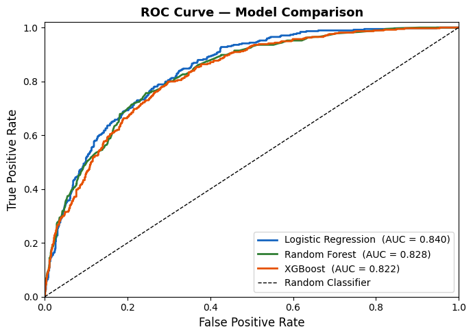

# Customer Churn Prediction

Predicts which telecom customers are likely to leave, and what drives them to churn.

Built during my Data Science internship at **XylofiAI** (Apr – May 2026).

## What it does
- Cleans the Telco Customer Churn dataset and engineers new features
- Handles class imbalance with SMOTE
- Trains and compares Logistic Regression, Random Forest and XGBoost
- Evaluates models with AUC-ROC
- Identifies the key churn drivers behind customers leaving

## Model comparison



## Files
- [`analysis.ipynb`](analysis.ipynb): the full analysis, from data cleaning to model evaluation
- [`summary.pdf`](summary.pdf): a short summary of the findings
- Telco Customer Churn dataset (CSV)

## Tech stack
Python · Pandas · scikit-learn · XGBoost · SMOTE

## Run locally
```bash
git clone https://github.com/abhinay1-11/Customer-Churn-Prediction.git
cd Customer-Churn-Prediction
pip install -r "requirements (1).txt"
jupyter notebook analysis.ipynb
```
